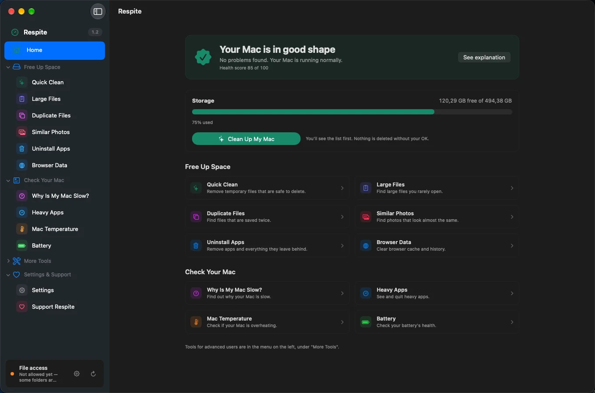
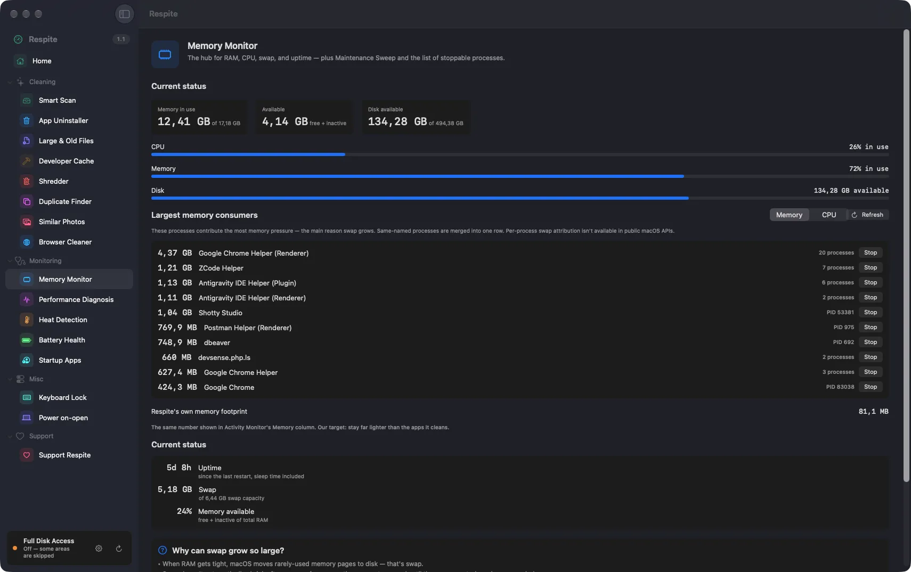
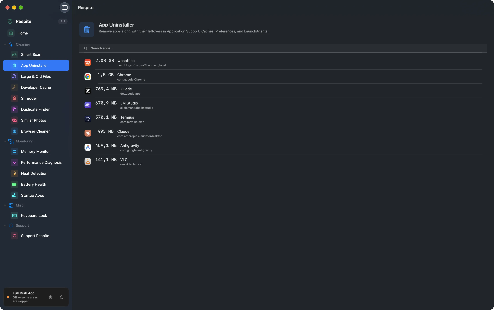

# Respite

A calm macOS cleaner. Free, local, and honest about what it can and can't do.


Most cleaning apps are built around fear: big red numbers, warnings about a "slow Mac", one-click magic that deletes first and explains later. Respite takes the opposite approach — it scans, explains what it found and why it's safe to remove, and moves everything to the Trash so you can undo. If a number can't be trusted, it doesn't show that number at all.

<p align="center">
  
</p>

<p align="center">
  
  
</p>

## What it does

**Cleaning**

- **Smart Scan** — caches, logs, and the Trash in one pass. Results are grouped per app, each with an explanation of why removal is safe.
- **App Uninstaller** — removes apps with their leftover data, and finds orphaned files left behind by apps you deleted long ago.
- **Large & Old Files**, **Duplicate Finder** (byte-identical, hard-link aware), **Similar Photos** (perceptual hashing, EXIF-aware).
- **Developer Caches** — Xcode, Homebrew, CocoaPods/SPM, Composer, Go, Cargo, node_modules, and local AI app logs (Ollama / LM Studio — models are never touched).
- **Browser Cleaner** — Chrome, Arc, Brave, Edge, Firefox, Safari. Running browsers are locked, with an explanation why.

**Monitoring**

- Menu bar with a live Health Score, memory/CPU/disk metrics, and one-click "Scan This Mac".
- Process management with Stop and Force Stop, plus plain-language failure reasons.
- Thermal state, CPU speed limit, battery health, uptime — measured, not guessed.
- **Keyboard Lock** — hold all key presses behind a full-screen overlay while you wipe the screen. Trackpad keeps working; auto-unlocks on a timer (default 2 minutes).
- **Power-on-when-lid-opens** toggle (firmware-level, reversible).

**Everywhere**

- Every scan keeps running when you switch modules; a global banner shows what's still scanning.
- Full Disk Access status is always visible in the sidebar, with a one-click path to fix it.
- English and Indonesian, switchable in Settings.

## How it stays safe

- Everything removable goes to the **Trash** first. The only irreversible module is the Shredder, behind layered confirmation.
- Every destructive action is written to an audit **ledger before** it runs — exportable from Settings.
- A hard-coded protected list guards system paths; your own exclusions sit on top, right-clickable from any result.
- First run of each action shows a dry-run preview.

## What it won't tell you

- It won't claim to clean "purgeable" space — macOS reclaims that on its own, and pretending otherwise is how cleaners inflate their numbers.
- On most modern Apple Silicon Macs, the CPU temperature sensor is locked away from all apps. Where it's readable, Respite shows it; where it isn't, it stays quiet instead of inventing a number.
- It has no background network activity. The only network call is "Check for Updates", and only when you press the button.

## Download

Get the latest DMG from [Ko-fi](https://ko-fi.com/s/b18fe31629) — pay what you want, **$0 included**. Drag to Applications.

The app is **not signed or notarized yet**, so macOS will warn you on first launch:
- Right-click the app → **Open**, or
- Go to **System Settings → Privacy & Security → Open Anyway**, or
- Run in Terminal:
  ```bash
  xattr -cr /Applications/Respite.app
  ```
That warning disappears once a Developer ID certificate is added to the release pipeline.

This repository contains the **source code** (GPL-3.0) — releases here are version tags, not app binaries. You can also build the DMG yourself from source; the app you get is identical to the Ko-fi download.

## Building from source

Requirements: Xcode 15+, [XcodeGen](https://github.com/yonaskolb/XcodeGen).

```bash
xcodegen generate
xcodebuild -project Respite.xcodeproj -scheme Respite \
  -configuration Release -destination 'platform=macOS' build CODE_SIGNING_ALLOWED=NO
```

The core logic lives in `RespiteCore`, a UI-free Swift package:

```bash
cd RespiteCore && swift test
```

## Why not the Mac App Store?

App Store apps must be sandboxed, and a sandboxed app cannot scan `~/Library`, read browser caches, manage login items, or stop processes. This isn't a workaround — it's the product. Respite is distributed directly, like most cleaners in this category (CleanMyMac included).

## License

[GPL-3.0](LICENSE). Use it, study it, change it — just keep derivatives open under the same terms.

Respite is distributed on [Ko-fi](https://ko-fi.com/s/b18fe31629) as pay-what-you-want, $0 included. If you want to tip or support ongoing development directly, you can visit [ko-fi.com/kabdullah](https://ko-fi.com/kabdullah). That's not a contradiction: the GPL explicitly allows selling copies at any price, and it guarantees the paid copy and the free copy are byte-for-byte the same app.
