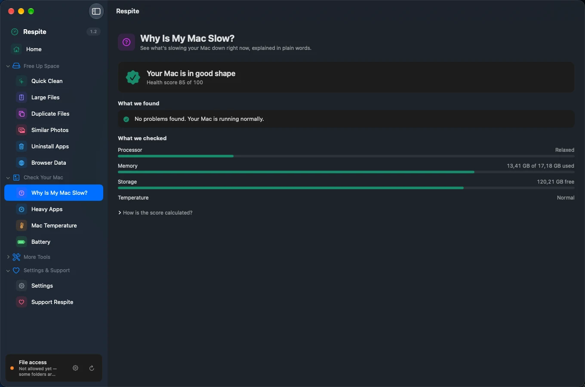
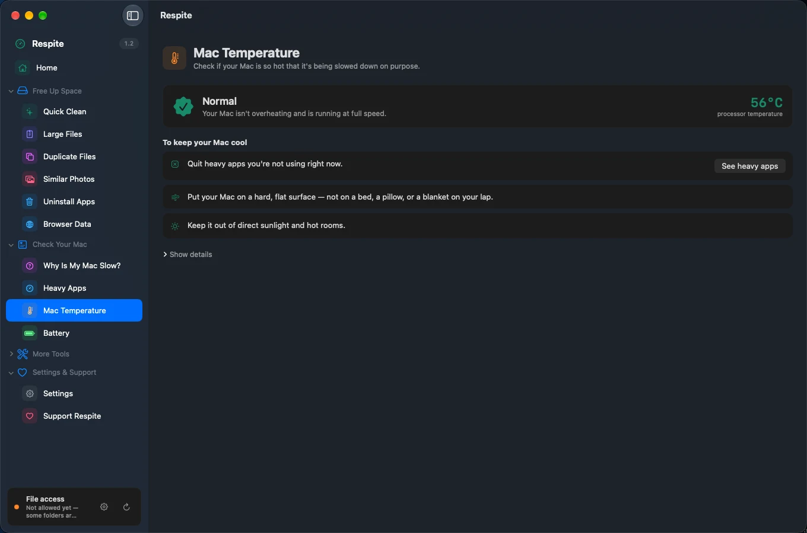

# Respite

A calm macOS cleaner. Free, local, and honest about what it can and can't do.


Most cleaning apps are built around fear: big red numbers, warnings about a "slow Mac", one-click magic that deletes first and explains later. Respite takes the opposite approach — it scans, explains what it found and why it's safe to remove, and moves everything to the Trash so you can undo. If a number can't be trusted, it doesn't show that number at all.

<p align="center">
  
</p>

<p align="center">
  
  
</p>

## What it does

Every tool works the same way: a short explanation, one **Start Scan** button, a clear "X GB can be freed" summary, and one main action. Technical details stay behind **Show details**.

**Free Up Space**

- **Quick Clean** — app caches and old logs in one pass, grouped per app, each with a reason why it's safe to remove.
- **Large Files** — big files you haven't opened in a long time. Recently used files are never pre-selected.
- **Duplicate Files** (exact copies, hard-link aware) and **Similar Photos** (near-identical shots, EXIF-aware). One copy in every group is always kept.
- **Uninstall Apps** — removes an app together with its leftover files, and finds leftovers from apps you deleted long ago.
- **Browser Data** — cache, history, or cookies for Chrome, Arc, Brave, Edge, Firefox, and Safari. Open browsers are skipped, with an explanation why.

**Check Your Mac**

- **Why Is My Mac Slow?** — a plain-language status, what was found, and a button that takes you straight to the fix.
- **Heavy Apps** — the apps using the most memory and processor power, with Quit and Force Quit, plus "refresh without restarting".
- **Mac Temperature** and **Battery** — measured, not guessed.
- Menu bar with a live health score, memory/storage/processor/temperature at a glance, and one-click **Clean Up Mac**.

**More Tools** (for advanced users, folded away by default)

- **Developer Cache** — Xcode, Homebrew, CocoaPods/SPM, Composer, Go, Cargo, node_modules, and local AI app logs (models are never touched).
- **Login Apps**, **Delete Permanently**, **Keyboard Lock** (hold key presses behind a full-screen overlay while you wipe the screen), and **Power On Lid Open** (firmware-level, reversible).

**Everywhere**

- Scans keep running when you switch tools; a banner shows what's still scanning.
- File-access permission status is always visible in the sidebar, with a one-click path to fix it.
- **English by default**, with full Indonesian — switch in Settings, which is also available right inside the main window.

## How it stays safe

- Everything removable goes to the **Trash** first. The only irreversible tool is Delete Permanently, behind a type-to-confirm step.
- Every destructive action is written to an audit **ledger before** it runs — exportable from Settings.
- A hard-coded protected list guards system paths; your own exclusions sit on top, right-clickable from any result.
- Every clean shows what will happen and asks first. Protected items are reported, never silently skipped or counted as "freed".

## What it won't tell you

- It won't claim to clean "purgeable" space — macOS reclaims that on its own, and pretending otherwise is how cleaners inflate their numbers.
- CPU temperature comes from the Mac's own sensors (Intel and Apple Silicon). If a Mac doesn't expose them, Respite shows the thermal state instead of inventing a number.
- It has no background network activity. The only network call is "Check for Updates", and only when you press the button.

## Download

Get the latest DMG from [Ko-fi](https://ko-fi.com/s/b18fe31629) — pay what you want, **$0 included**. Drag to Applications.

The app is **not signed or notarized yet**, so macOS will warn you on first launch:
- Right-click the app → **Open**, or
- Go to **System Settings → Privacy & Security → Open Anyway**, or
- Run in Terminal:
  ```bash
  xattr -cr /Applications/Respite.app
  ```
That warning disappears once a Developer ID certificate is added to the release pipeline.

This repository contains the **source code** (GPL-3.0) — releases here are version tags, not app binaries. You can also build the DMG yourself from source; the app you get is identical to the Ko-fi download.

## Building from source

Requirements: Xcode 15+, [XcodeGen](https://github.com/yonaskolb/XcodeGen).

```bash
xcodegen generate
xcodebuild -project Respite.xcodeproj -scheme Respite \
  -configuration Release -destination 'platform=macOS' build CODE_SIGNING_ALLOWED=NO
```

The core logic lives in `RespiteCore`, a UI-free Swift package:

```bash
cd RespiteCore && swift test
```

## Why not the Mac App Store?

App Store apps must be sandboxed, and a sandboxed app cannot scan `~/Library`, read browser caches, manage login items, or stop processes. This isn't a workaround — it's the product. Respite is distributed directly, like most cleaners in this category (CleanMyMac included).

## License

[GPL-3.0](LICENSE). Use it, study it, change it — just keep derivatives open under the same terms.

Respite is distributed on [Ko-fi](https://ko-fi.com/s/b18fe31629) as pay-what-you-want, $0 included. If you want to tip or support ongoing development directly, you can visit [ko-fi.com/kabdullah](https://ko-fi.com/kabdullah). That's not a contradiction: the GPL explicitly allows selling copies at any price, and it guarantees the paid copy and the free copy are byte-for-byte the same app.
